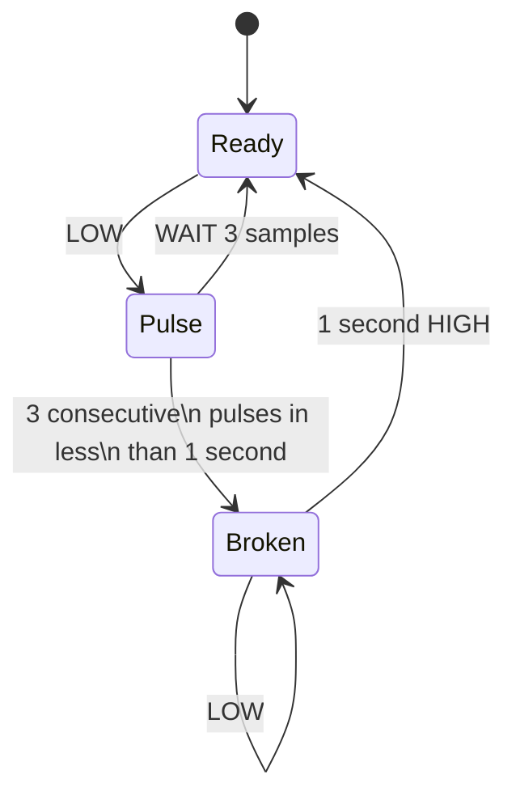

# aeon_beambreak_filter

This IR beam break processing code is a workaround to filter the adaptive threshold signal in the case where the beam is blocked by accidental obstruction. The following state machine describes the filtering operation:

<!-- ## 🌐 View Online (eCAD) -->

## Build your own

Check out the **[latest release](https://github.com/SainsburyWellcomeCentre/aeon_beambreak_filter/releases/latest)** for production Gerbers, BOM, and assembly drawings to build your own beambreak filter.

## 💻 Software Requirements

- **MicroPython** — Firmware runtime on the microcontroller, download the latest UF2 file for the Pi Pico from [MicroPython download page](https://micropython.org/download/rp2-pico/).

To view or edit the source design files:

- **KiCad** _(electronic design)_ — Download via [KiCad](https://www.kicad.org/download/)
- **Inventor 2025+** _(mechanical design)_ — Academic licenses via [Autodesk Education](https://www.autodesk.com/education/free-software/inventor)

## 📜 License

**Sainsbury Wellcome Centre hardware is released under** [Creative Commons Attribution-ShareAlike 4.0 International](http://creativecommons.org/licenses/by-sa/4.0/).

You are free to:

- **Share** — copy and redistribute the material in any medium or format
- **Adapt** — remix, transform, and build upon the material for any purpose

Under the following terms:

- **Attribution** — Give appropriate credit, link to the license, and indicate changes.
- **ShareAlike** — Distribute your contributions under the same license.
- **No additional restrictions** — Don't apply legal or technological measures that prevent others from doing anything the license permits.

> For the full legal text, see [LICENSE](LICENSE).

## 📧 Contact

- **Author**: [Sainsbury Wellcome Centre FabLabs](https://www.sainsburywellcome.org/content/fablab)
- **Email**: [swc.fablabs@ucl.ac.uk](mailto:swc.fablabs@ucl.ac.uk)
- **Website**: [FabLabs Documentation](https://sainsburywellcomecentre.github.io/fablabs-documentation/aeon_beambreak_filter)
